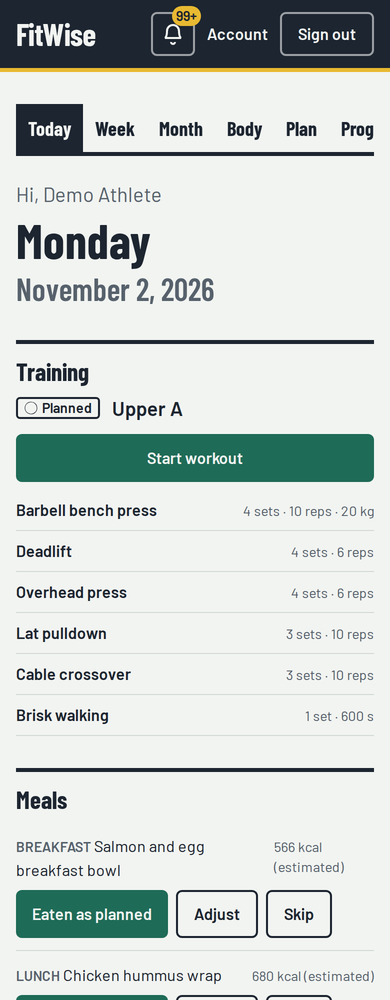
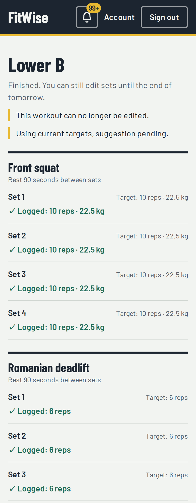
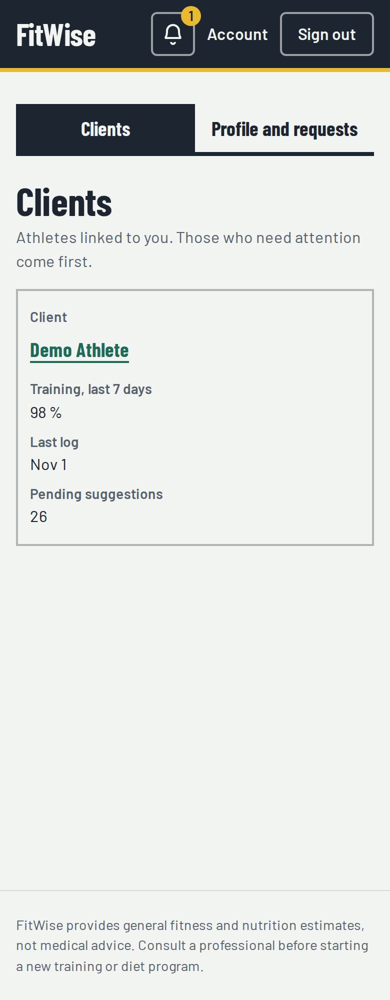
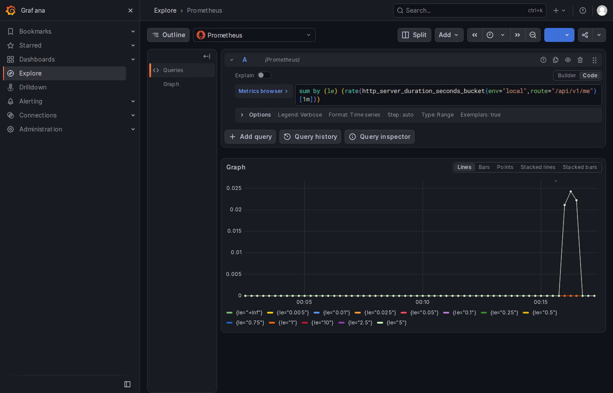
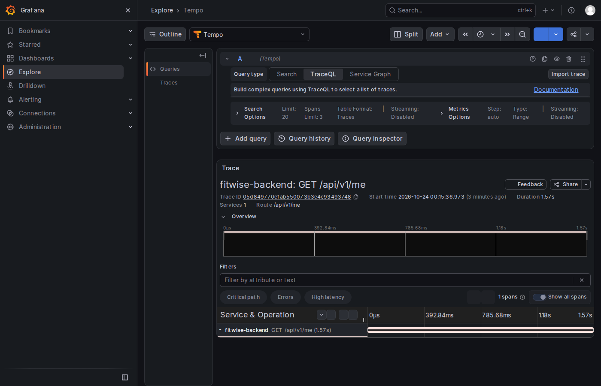
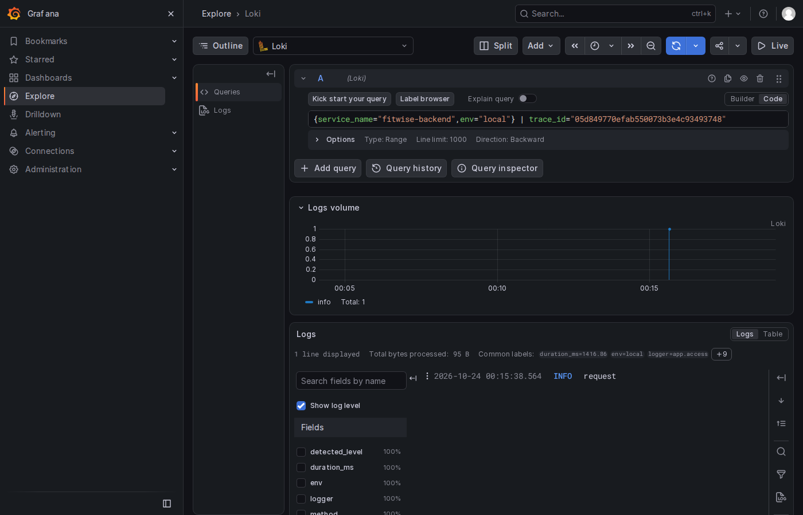

# FitWise

> **Test data only. The deployed environments are served over plain HTTP (no TLS). Do not enter real health data, real emails or real passwords.** See [Limitations](#limitations).

FitWise is a mobile-first web app that is a single source of truth for training and nutrition. It is the final project of the AI Dev Tools Zoomcamp 2026 and was built by a team of Claude Code agents (product manager, engineers, QA, DevOps/SRE) coordinated through GitHub Issues.

| Today | Workout | Coach dashboard |
|---|---|---|
|  |  |  |

## Problem

Most people who start training cannot afford a personal trainer. They track workouts in notes apps or spreadsheets, guess what weight to lift next, eat without knowing whether it matches their goal and never see whether they followed their plan. Experienced lifters have the opposite problem: workouts, food and body weight live in separate apps and nothing ties them together.

FitWise turns body metrics, lifestyle and a goal into calorie and macro targets, a weekly training plan and a meal plan. Each day the user logs sets and meals, sees planned vs. actual performance and estimated calories eaten vs. burned, and accepts or rejects an explained, rule-based suggestion for the next session. Users can switch to custom mode, and a linked human coach sees the same data, edits the plan and leaves notes. All guidance comes from deterministic, explainable rules (no AI/LLM in the product). FitWise is not a medical product; all numbers are estimates. Full text: [spec §1](docs/spec.md#1-problem).

## Features

Requirements F1 to F18 ([spec §5](docs/spec.md#5-functional-requirements), each with acceptance criteria):

| ID | Feature | ID | Feature |
|---|---|---|---|
| F1 | Accounts and authentication | F10 | Training logging |
| F2 | Onboarding and profile (athlete) | F11 | Progression engine |
| F3 | Calculation engine (targets) | F12 | Meal logging |
| F4 | Exercise catalog | F13 | Daily energy balance |
| F5 | Training plan generator | F14 | Body tracking and adaptive calories |
| F6 | Foods and meals | F15 | Progress and performance charts |
| F7 | Meal plan generator | F16 | Coach mode |
| F8 | Custom mode (plan editor) | F17 | In-app notifications |
| F9 | Calendar | F18 | Data ownership (export and account deletion) |

## Course criteria

| Course criterion | Where it is addressed |
|---|---|
| Problem description | [Problem](#problem), [spec §1](docs/spec.md#1-problem) |
| Product specification + tracker | [Documentation and tracker](#documentation-and-tracker), [docs/spec.md](docs/spec.md) |
| Agent team | [Agent team and process](#agent-team-and-process), [docs/team.md](docs/team.md), [docs/process.md](docs/process.md), [.claude/agents/](.claude/agents/) |
| Context management | [CLAUDE.md](CLAUDE.md), [docs/](docs/), [Documentation and tracker](#documentation-and-tracker) |
| Application | [Features](#features), [Run locally](#run-locally) |
| Testing | [Run locally](#run-locally) (`make test`, `make e2e`), [spec §10](docs/spec.md#10-testing-strategy) |
| Containerization | [Run locally](#run-locally), [spec §11](docs/spec.md#11-containerization-and-local-run), [compose.yaml](compose.yaml) |
| Deployment | [Deployed environments](#deployed-environments), [ADR 0010](docs/adr/0010-pull-based-deploy.md) |
| CI/CD | [CI/CD](#cicd), [.github/workflows/](.github/workflows/) |
| Observability | [Observability](#observability), [observability/README.md](observability/README.md) |
| Alerting on user impact | [Observability](#observability), [spec §15.1](docs/spec.md#151-alerts-grafana-managed-provisioned-as-code-envprod) |
| On-call agent | [On-call agent](#on-call-agent), [docs/runbooks/](docs/runbooks/README.md) |

## Documentation and tracker

| Doc | What it holds |
|---|---|
| [docs/spec.md](docs/spec.md) | Source of truth: requirements, formulas, data model, API outline, testing, deployment, CI/CD, observability, on-call, roadmap, decisions log |
| [CLAUDE.md](CLAUDE.md) | Entry point and rules for every agent |
| [docs/process.md](docs/process.md) | Issue lifecycle, branches, PRs, QA, releases, incidents |
| [docs/team.md](docs/team.md) | Agent roles and hand-offs |
| [docs/architecture.md](docs/architecture.md) | Components, request flow, environments |
| [docs/adr/](docs/adr/README.md) | Architecture decision records |
| [docs/runbooks/](docs/runbooks/README.md) | Incident runbooks used by the on-call agent |
| [openapi.yaml](openapi.yaml) | API contract (written before the implementation) |

All work is tracked in GitHub Issues with acceptance criteria and shown on the public [FitWise Backlog board](https://github.com/users/DanielB280320/projects/1).

## Architecture

A React + TypeScript SPA (Vite) is served by nginx, which proxies `/api` to a FastAPI backend (Python 3.12, SQLAlchemy 2, Alembic) on PostgreSQL 16. The calculation and suggestion rules are pure functions in `backend/app/engines/`. The API contract in `openapi.yaml` is written first and the frontend client is generated from it. The backend exports OpenTelemetry traces, metrics and logs to a collector feeding Prometheus, Loki, Tempo and Grafana. Details: [docs/architecture.md](docs/architecture.md), [ADR 0001](docs/adr/0001-stack-fastapi-react-postgres.md), [ADR 0004](docs/adr/0004-pure-calculation-engines.md).

## Deployed environments
> **Test data only.** Dev and prod are served over HTTPS through CloudFront ([ADR 0012](docs/adr/0012-https-via-cloudfront.md); prod since 2026-11-04). These are demo environments, so use test data, not real health data.
> **Test data only.** Dev is served over HTTPS through CloudFront ([ADR 0012](docs/adr/0012-https-via-cloudfront.md)). Prod is still plain HTTP until its distribution is approved and created: credentials and health data are not encrypted in transit there, so do not enter real health data ([ADR 0003](docs/adr/0003-plain-http-known-limitation.md)).

| Environment | URL | Health check (`/api/v1/healthz` returned 200 on 2026-11-01) |
|---|---|---|
| Dev (deployed automatically from `main`) | https://drjfx5qv8ht2r.cloudfront.net | [healthz](https://drjfx5qv8ht2r.cloudfront.net/api/v1/healthz) |
| Prod (promoted manually, with approval) | https://d3c78p667zuju.cloudfront.net | [healthz](https://d3c78p667zuju.cloudfront.net/api/v1/healthz) |

Both run Docker Compose on EC2 ([ADR 0002](docs/adr/0002-ec2-docker-compose-deployment.md), [spec §12](docs/spec.md#12-deployment-aws)). Register your own test account there; the demo accounts below exist on the local stack only.

## CI/CD

| Workflow | File | What it does |
|---|---|---|
| CI | [ci.yml](.github/workflows/ci.yml) | On every PR and push to `main`: lint, tests, scans, image builds; the aggregate check **CI passed** gates merging |
| Deploy to dev | jobs `deploy-dev` and `smoke-dev` in [ci.yml](.github/workflows/ci.yml) | After CI passes on `main`: publishes images and moves the dev tag, then smoke-tests dev |
| Promote to production | [promote-prod.yml](.github/workflows/promote-prod.yml) | Manual, needs approval; verifies the tag and moves the prod ref, then `smoke-prod` |
| Rollback production | [rollback-prod.yml](.github/workflows/rollback-prod.yml) | Manual; points prod back at the previous tag, then verifies |

The deploy is **pull-based**: the hosts poll the approved tag, so CI holds no AWS credentials ([ADR 0010](docs/adr/0010-pull-based-deploy.md), [spec §13](docs/spec.md#13-cicd-github-actions)). Migrations run in a separate step so a rollback never needs a down-migration ([ADR 0009](docs/adr/0009-separate-migration-step.md)).

## Observability

OpenTelemetry from the backend to Prometheus (metrics), Loki (logs) and Tempo (traces), viewed in Grafana, with metric exemplars linking to traces and trace IDs linking to logs. Health data never reaches telemetry ([spec §6.5](docs/spec.md#65-privacy-health-data), [spec §14](docs/spec.md#14-observability)). Run it locally with `make up-obs`; see [observability/README.md](observability/README.md).





Two Grafana-managed alerts watch user impact on the logging endpoints (KeyJourneyErrors: 5xx ratio above 5 %; KeyJourneyLatency: p95 above 1 s), provisioned as code ([spec §15.1](docs/spec.md#151-alerts-grafana-managed-provisioned-as-code-envprod)).

## On-call agent

A responder service on the prod host receives the Grafana webhook, saves context and launches headless Claude Code with a runbook prompt and a strict tool allow-list. It applies one runtime mitigation (feature flag, rollback or restart), opens an incident issue and a fix PR ([spec §15.2](docs/spec.md#152-on-call-responder), [ADR 0007](docs/adr/0007-on-call-agent-with-allow-listed-mitigations.md)).

- Runbooks: [docs/runbooks/](docs/runbooks/README.md), [key-journey-errors.md](docs/runbooks/key-journey-errors.md), [key-journey-latency.md](docs/runbooks/key-journey-latency.md).
- **Status (#69):** code merged (PRs #143, #165), live verification on prod pending.
- Demo scenarios ([spec §15.3](docs/spec.md#153-demo-scenarios-documented-in-docsrunbooks), [how to trigger](docs/runbooks/README.md#demo-scenarios-spec-153)):

| Scenario | Fault | Expected mitigation | Status |
|---|---|---|---|
| S1 | Bad release: finishing a workout raises an error | `rollback.sh` | documented, run pending |
| S2 | Faulty engine: `progression_engine=v2` fails on bodyweight exercises | `flag.sh progression_engine v1` | documented, run pending |

## Agent team and process

Product manager, Engineer, QA and DevOps/SRE agents (definitions in [.claude/agents/](.claude/agents/)) work from GitHub Issues: the PM grooms issues with testable acceptance criteria, an Engineer implements on a branch and opens a PR with `Closes #N`, QA verifies every criterion independently, and the orchestrator merges on PASS with green CI. Status labels mirror the board columns. See [docs/team.md](docs/team.md) and [docs/process.md](docs/process.md).

## Run locally

The five commands you need:

```bash
make up          # full stack at http://localhost:8088
make seed-demo   # demo athlete with 8 weeks of history + a linked coach
make test        # backend unit + integration, frontend tests
make e2e         # Playwright journeys against the running stack
make lint        # ruff, mypy, eslint, tsc, client drift, OpenAPI lint
```

Demo logins created by `make seed-demo` (test data only): `demo.athlete@fitwise.test` and
`demo.coach@fitwise.test`, both with password `demo-password-123`.

Prerequisites: Docker with Compose v2. For `make test`, `make lint` and `make e2e` also
[uv](https://docs.astral.sh/uv/) and Node.js 24 with npm >= 9.5 (`frontend/.nvmrc`).

```bash
cp .env.example .env   # optional: `make up` does it if .env is missing
make up                # db + backend + frontend, returns when all are healthy
open http://localhost:8088
make down              # stop; the database volume is kept
make clean             # stop and DELETE the database volume
```

The app (SPA and `/api`) is published on `127.0.0.1:${HTTP_PORT}`, default **8088**. Every
setting is an environment variable documented in [.env.example](.env.example). `make help` lists
all targets.

| Command | What it does |
|---|---|
| `make up` | `docker compose up --build --wait`: db, the one-shot `migrate` step (migrations + seed), then backend and frontend |
| `make test` | Backend unit + integration tests (throwaway Postgres container on `127.0.0.1:${TEST_DB_PORT}`, default 15432) and frontend tests. Uses `TEST_DATABASE_URL` instead if it is already set |
| `make lint` | ruff, ruff format --check, mypy, eslint, tsc, generated API client up to date (`npm run check:api`), `openapi.yaml` lint (Redocly) |
| `make e2e` | Playwright project in `e2e/` against the running stack (`BASE_URL`, #65) |
| `make check-log-privacy` | Smoke check (stack running) that no query string, user UUID or numeric id in a path, client IP, referrer or token reaches container logs, and that nginx access lines are valid JSON; with the backend up and down |
| `make contract-smoke` | Contract smoke (stack running): schemathesis checks the responses of every operation the backend serves against `openapi.yaml`, with a throwaway signed-in athlete |
| `make scan` | Security scans: `scan-secrets` (gitleaks, full history; run from a regular clone), `scan-deps` (pip-audit, npm audit), `scan-images` (Trivy, HIGH/CRITICAL with a fix) |
| `make up-obs` | The app plus the observability stack (OTel Collector, Prometheus, Loki, Tempo, Grafana at `http://localhost:${GRAFANA_PORT}`, default 3030); the backend exports to it. `make check-obs` verifies metric/exemplar/trace/log correlation and the privacy gate; `make down-obs` / `make clean-obs` stop it. See [observability/README.md](observability/README.md) |
| `make rollback-compat` | Rollback guard: builds the previous release's backend image (`PREV_REF`, default the merge-base with `origin/main`) and this tree's, migrates with the new one, rolls back without the migration step and checks `readyz` (own Compose project, nothing published) |
| `make seed-demo` | Load the demo athlete + coach with 8 weeks of history into the running stack (see "Demo data" below). Refuses in prod |
| `make build TAG=<sha>` | Build `<IMAGE_PREFIX>-backend:<TAG>` and `<IMAGE_PREFIX>-frontend:<TAG>` |

### CI

[`.github/workflows/ci.yml`](.github/workflows/ci.yml) runs on every pull request and every push
to `main`, using the make targets above: backend lint and tests (Postgres 16 service), frontend
lint/type-check/client drift/tests, OpenAPI lint, secret and dependency scans, both image builds
with a Trivy scan (never pushed), then the stack is started for `make contract-smoke` and
`make check-log-privacy`. When a change touches migrations, the backend image or `compose*.yaml`,
the job **Rollback compatibility** runs `make rollback-compat` against the PR's base. `main` requires the aggregate check **CI passed**. Intentional fake
credentials in tests need a trailing `# gitleaks:allow` comment.

### Migrations, deploys and rollbacks

Migrations and the F4.1 seed run only in the one-shot `migrate` service, from the same image as
the backend (`python -m app.migrate`). The backend container only starts the app; it never
migrates or seeds, so a restart never touches the schema and an older image can always start
on a newer schema (spec §11, §13; D50, ADR 0009).

| Situation | Command |
|---|---|
| Local | `make up` (the backend waits for `migrate` to exit 0) |
| Forward deploy | `TAG=<sha> docker compose run --rm migrate && TAG=<sha> docker compose up -d --no-deps --wait backend frontend` |
| Rollback | `TAG=<PREVIOUS_TAG> docker compose up -d --no-deps --wait backend frontend` (no migration step, no down-migration) |
| Restart | `docker compose restart backend` (no migration step) |

The forward deploy runs the step on its own first: if a migration fails, it exits non-zero and
the running backend keeps serving the old tag. A plain `docker compose up` would also run the
step first, but it replaces the old backend container before the step finishes.

### Several stacks side by side

Each checkout uses `COMPOSE_PROJECT_NAME=fitwise`, port 8088 and test port 15432 by default,
so two checkouts (for example parallel agent worktrees under `../fitwise-wt/<issue>`) would share
one Compose project and its database volume, and collide on the ports. Give each one its own
values in its `.env`:

```bash
# ../fitwise-wt/21/.env
COMPOSE_PROJECT_NAME=fitwise-21
HTTP_PORT=8121
TEST_DB_PORT=15421
# only for `make up-obs`:
GRAFANA_PORT=3121
OTLP_HTTP_PORT=14321
FLUENT_FORWARD_PORT=24321
```

or, for a single command, in the environment (it takes precedence over `.env`):

```bash
COMPOSE_PROJECT_NAME=fitwise-21 HTTP_PORT=8121 TEST_DB_PORT=15421 make up test
```

On Windows/WSL with Docker Desktop, pick ports below 49152: Windows reserves the dynamic range
above it and Docker Desktop may fail to publish there.

## Demo data

With the stack running (`make up`), `make seed-demo` loads one athlete with 8 weeks of training,
meal and weight history plus one linked coach. It is a backend command (`python -m app.cli.seed_demo`)
run after the migration step, never on app start. Running it again changes nothing; if an earlier run
failed half-way, the next run rebuilds the two demo accounts. It refuses to run when `APP_ENV` or
`FITWISE_ENV` is `prod`, and it logs counts only.

Test data only, never use these credentials anywhere real:

| Role | Email | Password |
|---|---|---|
| Athlete | `demo.athlete@fitwise.test` | `demo-password-123` |
| Coach | `demo.coach@fitwise.test` | `demo-password-123` |

The history is 56 days (`HISTORY_DAYS` in `backend/app/demo_seed.py`): the athlete onboards 56 days
before the day you run the seed, and the last logged day is **yesterday** (athlete time zone
Europe/Madrid); today is left open so you can log live. It is relative to the day you run it, so
re-seed a fresh database (`make clean`, `make up`, `make seed-demo`) when it gets old. The progress
charts accept `weeks` of 4, 12, 26 or 52.

## Feature flags

Runtime flags live in the `feature_flag` table (allow-list and defaults in
`backend/app/config.py` `FEATURE_FLAGS`: `progression_engine` v1|v2, `off_search_enabled`
true|false, `fault_injection_latency_ms` 0..10000). Change one on the running stack with:

```bash
oncall/ops/flag.sh <key> <value>                 # actor oncall-agent; FLAG_ACTOR=owner to override
docker compose exec -T backend python -m app.cli.flags list
```

Unknown keys or invalid values exit non-zero and change nothing. Running backends pick the change
up within 5 s (`FLAG_CACHE_TTL_SECONDS`), without a restart.

## Limitations

| Limitation | Impact | Source |
|---|---|---|
| Plain HTTP, no domain or TLS | Credentials and health data are not encrypted in transit; use test data only. HTTPS is roadmap item 1 | [spec §6.4](docs/spec.md#64-security), [ADR 0003](docs/adr/0003-plain-http-known-limitation.md) |
| The exercise-note `session_id` is not validated against the exercise | The session must belong to the athlete, but it is not checked that the noted exercise was part of it, so a note can point at an unrelated session | #49, [PR #194](https://github.com/DanielB280320/AiDevToolsZoomcamp_FinalProject/pull/194) |
| Seed wording drift | The spec and issue say the demo history runs "up to today"; the seed as built ends yesterday and leaves today open (this README states the built behaviour). `weeks=8` is not a valid chart parameter (4, 12, 26, 52 only) | #51, [PR #195](https://github.com/DanielB280320/AiDevToolsZoomcamp_FinalProject/pull/195) |
| The F18 data export can contain a coach-set `planned_meal.meal_id` | A meal id that a coach set in the athlete's plan can appear in the export. Basis: [spec §19 D66](docs/spec.md#19-decisions-log) | #50, [PR #196](https://github.com/DanielB280320/AiDevToolsZoomcamp_FinalProject/pull/196) |
| `POST /me/delete` has no rate limit on password attempts | A signed-in session could guess the confirmation password without being throttled | #50, [PR #196](https://github.com/DanielB280320/AiDevToolsZoomcamp_FinalProject/pull/196) |
| On-call agent not yet verified live | Code merged (PRs #143, #165), live verification on prod pending; demo scenarios S1 and S2 are documented, run pending | #69 |

## Roadmap

From [spec §17](docs/spec.md#17-roadmap-post-mvp):

1. HTTPS (domain or sslip.io + Caddy/Let's Encrypt), `Secure` cookies.
2. Spanish UI.
3. Body-fat estimate from a face-free photo (explicit consent, processed in memory, never stored, EXIF stripped, result as a range, behind a flag).
4. Paid coaching: coach marketplace, subscriptions via a billing provider behind an interface; `CoachLink.source = subscription`; `Entitlement` checks.
5. Email/push notifications; PWA/offline logging.
6. Barcode scanning; richer food databases.
7. Infrastructure as code (Terraform/CDK).
8. Wearable integrations.
