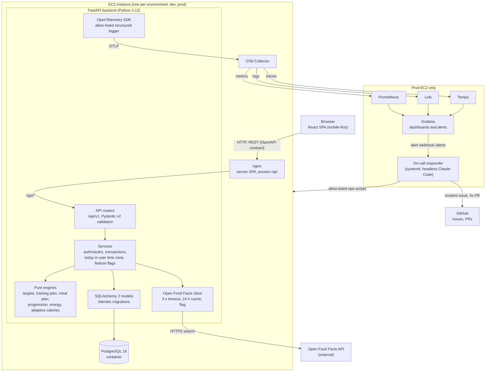
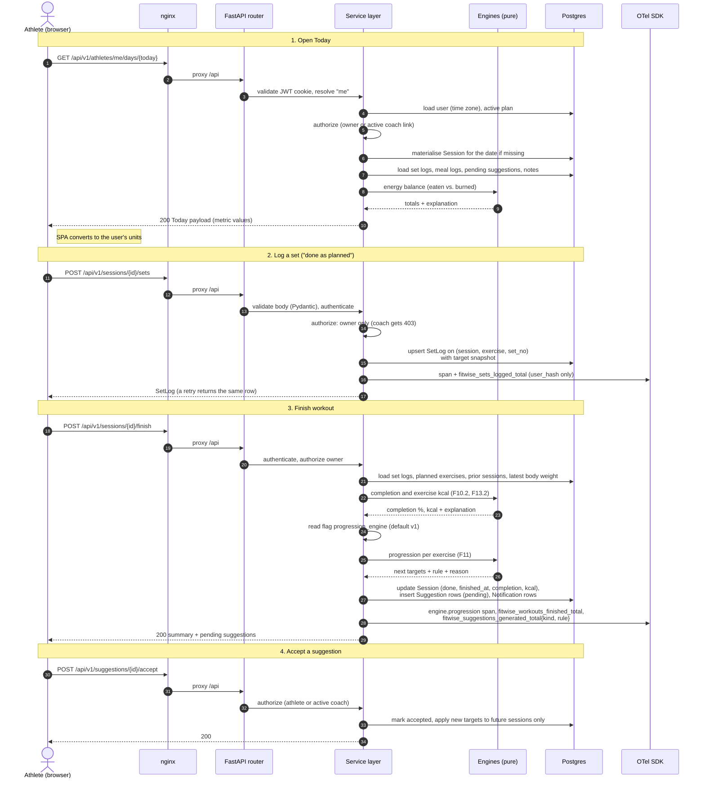
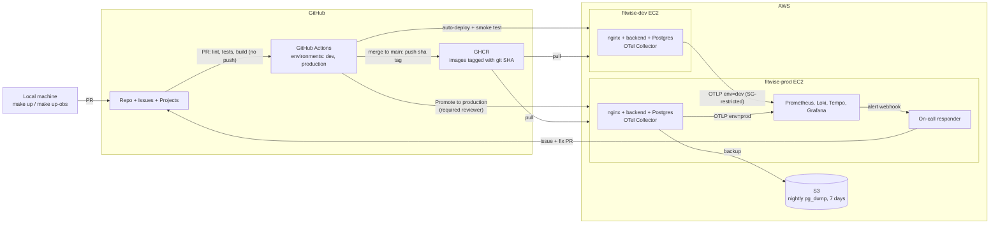
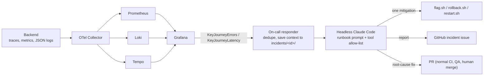

# FitWise architecture

This document describes how FitWise is put together: the components, how a request flows through them, where each environment runs, and the design decisions behind it. It summarises [spec.md](spec.md); when the two disagree, **the spec wins** and this document is fixed.

| Related | |
|---|---|
| Requirements and data model | [spec §5 Functional requirements](spec.md#5-functional-requirements), [§8 Data model](spec.md#8-data-model-main-entities) |
| API contract | [`openapi.yaml`](../openapi.yaml), outline in [spec §9](spec.md#9-api-outline) |
| Decisions | [spec §19 Decisions log](spec.md#19-decisions-log) and the ADRs in [`docs/adr/`](adr/README.md) |
| Workflow | [process.md](process.md), [team.md](team.md) |

## 1. Overview

FitWise is a single-page web app backed by a JSON REST API and one PostgreSQL database. All guidance (targets, plans, progression, calorie adjustments) comes from **deterministic, explainable rule engines**; there is no AI/LLM in the product ([spec §1](spec.md#1-problem)). Each environment is one EC2 instance running the whole app with Docker Compose. The prod instance also runs the observability stack and the on-call responder.

## 2. Components



| Component | Responsibility | Spec |
|---|---|---|
| **React SPA** | Today / Week / Month calendar, logging, plan editor, charts, coach dashboard. React + TypeScript + Vite, TanStack Query for server state, Recharts, react-i18next (English now, i18n-ready), Tailwind. Unit conversion happens here, at the edge. | [§6.1](spec.md#61-usability), [§6.2](spec.md#62-internationalisation-and-units), [§7.1](spec.md#71-tech-stack) |
| **Generated API client** | TypeScript client generated from `openapi.yaml`; the SPA never hand-writes request types. | [§7.1](spec.md#71-tech-stack), [ADR 0005](adr/0005-contract-first-openapi.md) |
| **nginx** | Serves the built SPA and reverse-proxies `/api` to the backend, so the browser talks to one origin on port 80. | [§7](spec.md#7-architecture), [§11](spec.md#11-containerization-and-local-run) |
| **API routers** | All paths under `/api/v1`. Pydantic v2 validates every request and response. `GET /healthz`, `GET /readyz` for health checks. | [§6.4](spec.md#64-security), [§9](spec.md#9-api-outline) |
| **Services** | Authentication (JWT in an `HttpOnly`, `SameSite=Lax` cookie), server-side authorization (owner or actively linked coach), DB transactions, resolving "today" in the user's time zone, reading feature flags, calling engines and persisting their results. | [F1](spec.md#f1-accounts-and-authentication--must), [F16](spec.md#f16-coach-mode--must) |
| **Engines** (`backend/app/engines/`) | Pure functions: plain inputs in, result plus `explanation`/`reason` out. No database, HTTP or clock access. Constants live in one config module. | [F3](spec.md#f3-calculation-engine-targets--must), [F5](spec.md#f5-training-plan-generator--must), [F7](spec.md#f7-meal-plan-generator--must), [F11](spec.md#f11-progression-engine--must), [F13](spec.md#f13-daily-energy-balance--must), [F14](spec.md#f14-body-tracking-and-adaptive-calories--must), [ADR 0004](adr/0004-pure-calculation-engines.md) |
| **Persistence** | SQLAlchemy 2 models for the entities in spec §8; Alembic migrations that are always backward compatible (expand, migrate, contract). Everything stored in metric units, timestamps in UTC. | [§8](spec.md#8-data-model-main-entities), [§13](spec.md#13-cicd-github-actions) |
| **Open Food Facts client** | Text search for packaged foods, `User-Agent: FitWise/<version> (<contact>)`, 3 s timeout, 24 h server-side cache, behind the flag `off_search_enabled`. A failure returns a handled "unavailable" response, never a 500. Selected products are copied into `Food`. | [F6](spec.md#f6-foods-and-meals--must) |
| **PostgreSQL 16** | Single database per environment, in a container. Prod has nightly `pg_dump` to S3 with 7-day retention. | [§12](spec.md#12-deployment-aws) |
| **Telemetry** | OpenTelemetry SDK (FastAPI, SQLAlchemy and outgoing HTTP auto-instrumented; custom `engine.*` spans) and a structured JSON logger with an allow-list of fields. Users are identified only by `user_hash`. | [§6.5](spec.md#65-privacy-health-data), [§14](spec.md#14-observability) |
| **OTel Collector** | Runs on every instance. The dev collector forwards to the prod collector (OTLP port open only to the dev instance); all telemetry is labelled `env=dev\|prod`. | [§7](spec.md#7-architecture), [§12](spec.md#12-deployment-aws), [§14](spec.md#14-observability) |
| **Prometheus, Loki, Tempo, Grafana** | Self-hosted on the prod instance. Dashboards and alert rules are provisioned as code. Grafana links metric exemplars to traces to logs by `trace_id`. | [§14](spec.md#14-observability), [§15.1](spec.md#151-alerts-grafana-managed-provisioned-as-code-envprod), [ADR 0006](adr/0006-self-hosted-observability-on-prod.md) |
| **On-call responder** | Python webhook receiver on the prod host that launches headless Claude Code with a runbook prompt and a strict tool allow-list (flag, rollback, restart), then opens an incident issue and a fix PR. | [§15.2](spec.md#152-on-call-responder), [ADR 0007](adr/0007-on-call-agent-with-allow-listed-mitigations.md) |

### 2.1 Backend layering

```
routers (HTTP, Pydantic schemas)
   └─► services (auth, authorization, transactions, clock, time zone, flags)
          ├─► engines (pure: inputs → result + explanation)
          └─► models / SQLAlchemy session → Postgres
```

Only services touch the database, the clock, feature flags and external HTTP. They gather the inputs, call an engine, and store the engine's output together with its inputs and explanation (for example `Targets.explanation` and `Targets.inputs`, `Suggestion.rule` and `Suggestion.reason`). This keeps every number the user sees reproducible and explainable ([spec §2.1 G3](spec.md#21-goals-mvp)).

Engine versions are chosen by the service from a feature flag (for example `progression_engine`, default `v1`, unknown values fall back to `v1`, [F11.5](spec.md#f11-progression-engine--must)). The engine itself never reads the flag.

### 2.2 Data model highlights

The full entity list is in [spec §8](spec.md#8-data-model-main-entities). Rules that shape the architecture:

- **Plans are versioned.** A `Plan` has `version` and `source` (`generated`/`custom`); regenerating creates a new version and keeps the old ones read-only. Every edit is recorded in `PlanChange` with the author ([F8](spec.md#f8-custom-mode-plan-editor--must)).
- **History uses snapshots, not references.** `SetLog` stores the target reps/weight/seconds it was performed against, so editing the plan never changes past sessions or charts ([F8.1](spec.md#f8-custom-mode-plan-editor--must), [F15.2](spec.md#f15-progress-and-performance-charts--must)).
- **Sessions are materialised lazily.** The weekly template repeats indefinitely; a `Session` row is created for a date the first time it is viewed or logged ([F9](spec.md#f9-calendar--must)).
- **Suggestions are data, not side effects.** Engines produce `Suggestion` rows with status `pending`; only an explicit accept by the athlete or linked coach changes targets ([F11](spec.md#f11-progression-engine--must), [F14](spec.md#f14-body-tracking-and-adaptive-calories--must)).
- **Metric and UTC in storage.** kg, cm, kcal and grams in the database; dates in UTC; "today" and week boundaries computed in the user's time zone ([§6.2](spec.md#62-internationalisation-and-units)).
- **Coach access is a link, not a role grant.** Authorization checks an active `CoachLink` on every athlete-scoped request; ending the link revokes access immediately ([F16](spec.md#f16-coach-mode--must)).

## 3. Request flow: the key journey

The key user journey is *Today → log sets / check off meals → finish workout → suggestions generated* ([spec §14](spec.md#14-observability)). Its logging endpoints carry the SLOs ([§6.6](spec.md#66-performance-and-reliability-targets-slos)) and the user-impact alerts ([§15.1](spec.md#151-alerts-grafana-managed-provisioned-as-code-envprod)).



Points the diagram encodes:

- **Idempotency.** Logging a set is an upsert keyed by (session, exercise, set number), so a retry on a flaky phone connection never duplicates a set ([F10.1](spec.md#f10-training-logging--must)). Meal check-off works the same way per (date, planned meal) ([F12.3](spec.md#f12-meal-logging--must)).
- **Authorization on every request.** The owner can log; an actively linked coach can read, edit the plan and decide suggestions but gets 403 on logging endpoints ([F16.4](spec.md#f16-coach-mode--must)).
- **Telemetry is anonymous.** Spans, metrics and logs carry route, status, `trace_id` and `user_hash`, never names, emails, weights, food names or notes ([§6.5](spec.md#65-privacy-health-data)).
- **Engines are called, not consulted.** All I/O (clock, time zone, flags, database) happens in the service before and after the engine call, which is what makes the engines table- and property-testable ([§10](spec.md#10-testing-strategy)).

## 4. Environments



| Environment | Where | How it gets code | What runs | Access |
|---|---|---|---|---|
| **Local** | Developer or agent machine | Working tree / worktree | `make up`: Postgres, backend (migrations + seed on start), frontend (nginx). `make up-obs` adds the observability stack. `make seed-demo` loads a demo athlete and coach. | `localhost` |
| **CI** | GitHub Actions runners | Every PR and every merge to `main` | Lint, type-check, unit + integration tests against a Postgres service, frontend tests, OpenAPI validation, secret scan, image build. Integration tests use the Open Food Facts fake. | n/a |
| **Image registry** | GHCR | Built once per commit on merge to `main` | Images tagged with the git SHA; the same image is promoted from dev to prod. | Pulled by the EC2 hosts |
| **dev** | `fitwise-dev` EC2, Docker Compose | Auto-deploy on every merge to `main`, then smoke test (`/readyz` + e2e smoke) | App stack + OTel Collector, forwarding to prod | Public DNS over HTTP, port 80 |
| **prod** | `fitwise-prod` EC2, Docker Compose | Manual "Promote to production" of a SHA already on dev; `production` environment needs approval. Failed smoke test rolls back to `PREVIOUS_TAG` automatically. | App stack, observability stack, on-call responder (systemd), nightly `pg_dump` to S3 | Public DNS over HTTP, port 80; Grafana restricted to the owner's IP |

Release mechanics ([spec §12](spec.md#12-deployment-aws), [§13](spec.md#13-cicd-github-actions), [process.md §9](process.md#9-releases)):

- Each host keeps `CURRENT_TAG` and `PREVIOUS_TAG`. Rollback means redeploying `PREVIOUS_TAG`, either from the "Rollback production" workflow or from the on-call agent's `rollback.sh`.
- Because migrations are expand → migrate → contract, the previous release always works against the current schema and rollback never needs a down-migration.
- Security groups: 80 open; 22 restricted to the owner's IP and GitHub Actions deploy (or SSM); Grafana restricted to the owner's IP; the prod OTLP port open only to the dev instance. Elastic IPs keep the addresses stable.
- Configuration and secrets (JWT secret, DB credentials, API keys) come from environment variables / GitHub Environment secrets; `.env.example` documents them and nothing secret is committed.

## 5. Observability and incident flow



- Alerts fire on user impact only: 5xx ratio > 5 % (≥ 20 requests, 5 min) or p95 > 1 s (10 min) on the logging endpoints ([§15.1](spec.md#151-alerts-grafana-managed-provisioned-as-code-envprod)).
- The responder can query Prometheus/Loki/Tempo and `docker compose ps/logs` read-only, apply one allow-listed mitigation, verify recovery for 5 minutes, then report. It cannot write to the database, read other secrets or run arbitrary shell; its fix PR goes through the normal process and never reaches `main` directly ([§15.2](spec.md#152-on-call-responder)).
- Demo scenarios S1 (bad release → rollback), S2 (faulty engine version → flag) and optional S3 (latency fault flag) are documented in `docs/runbooks/` ([§15.3](spec.md#153-demo-scenarios-documented-in-docsrunbooks)).

## 6. Key design decisions

Each decision is recorded in the [spec decisions log](spec.md#19-decisions-log); the ones with architectural trade-offs have an ADR.

| ADR | Decision | Decisions log |
|---|---|---|
| [0001](adr/0001-stack-fastapi-react-postgres.md) | Stack: FastAPI + React + PostgreSQL | D1 |
| [0002](adr/0002-ec2-docker-compose-deployment.md) | Deploy with Docker Compose on two EC2 instances (dev, prod), Postgres in a container, images in GHCR | D2, D3 |
| [0003](adr/0003-plain-http-known-limitation.md) | Serve over plain HTTP on the EC2 public DNS name as a documented limitation | D4 |
| [0004](adr/0004-pure-calculation-engines.md) | Calculation engines are pure, deterministic functions that explain their output | §1, F3, F11 |
| [0005](adr/0005-contract-first-openapi.md) | `openapi.yaml` is the API source of truth; the frontend client is generated | §7.1, §9 |
| [0006](adr/0006-self-hosted-observability-on-prod.md) | Self-host Prometheus, Loki, Tempo and Grafana on the prod EC2 | D32, D34 |
| [0007](adr/0007-on-call-agent-with-allow-listed-mitigations.md) | On-call agent limited to flag / rollback / restart, then issue + fix PR | D33 |

Other decisions that shape the code but need no separate ADR, because the spec states them fully:

- **Own email + password auth with a JWT cookie** (D8, [F1](spec.md#f1-accounts-and-authentication--must)).
- **Store metric, display user units; UTC storage, "today" in the user's time zone** (D6, [§6.2](spec.md#62-internationalisation-and-units)).
- **Snapshots for history** and **backward-compatible migrations** ([§8](spec.md#8-data-model-main-entities), [§13](spec.md#13-cicd-github-actions)).
- **Suggestions require acceptance** (D19, D29).
- **Health data never reaches telemetry** ([§6.5](spec.md#65-privacy-health-data)).

New decisions with trade-offs get a new ADR (copy [0000-template.md](adr/0000-template.md)) linked from the spec, as described in [process.md §8](process.md#8-changing-the-spec).
